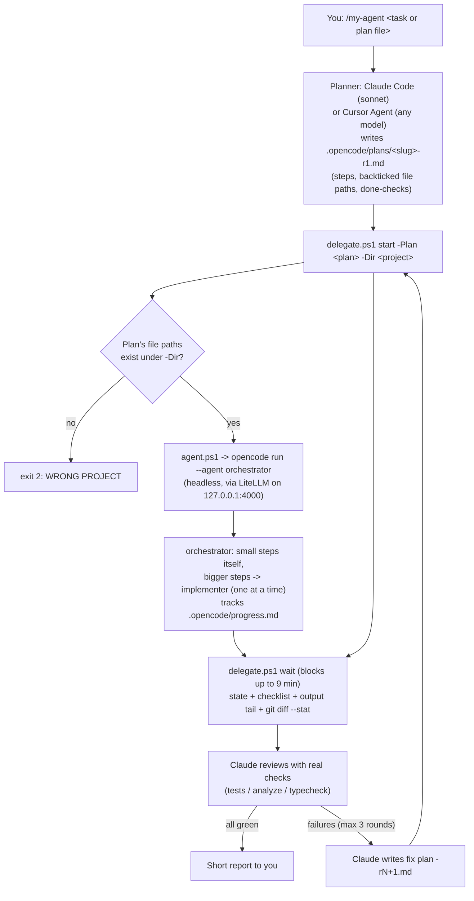

# my-agent

**Claude plans and reviews. A cheap model writes the code.**

my-agent is a small, opinionated coding workflow for **Windows (PowerShell 5.1+)**:

- **Claude Code** (model `sonnet`, e.g. inside the Cursor IDE extension) **or Cursor's own Agent** (any model you pick in Cursor) only **plans** and **reviews**.
- A cheap **OpenCode** agent called **my-agent** (`orchestrator` + `implementer`) does the actual **implementation**.
- A local **LiteLLM** proxy routes my-agent's requests through a chain of **free** providers (Kilo -> OpenRouter -> Gemini -> NVIDIA NIM -> optional GLM bridge -> optional **local Ollama model**) with instant fallbacks on rate limits and errors. The local model is switched on/off and chosen in `.env` (`MYAGENT_LOCAL`, `MYAGENT_LOCAL_MODEL`).

### Why?

Claude tokens are expensive, and most of them get burned while the model reads files, writes code, runs tests and fixes small mistakes. Planning and judging the result is where Claude is worth its price. So my-agent splits the work: Claude writes a precise plan, a cheap model does the long, token-heavy part, and Claude checks the result with real commands (tests, analyzer, typecheck) and sends back a short fix plan if needed. Changes of about 3 lines or fewer, Claude simply makes itself.

my-agent **never commits or pushes**.

> Built for and tested on Windows. macOS/Linux users would need to port the `.ps1` scripts (mainly `delegate.ps1`, `agent.ps1`, `start-litellm.ps1`); the agent prompts, skill and LiteLLM config are platform-neutral.

## How the loop works



## Components

| Path | What it is | Installed to |
|---|---|---|
| `claude/skills/my-agent/SKILL.md` | Claude Code user skill behind `/my-agent` (`disable-model-invocation: true`, `model: sonnet`). Must be **UTF-8 without BOM**. | `~/.claude/skills/my-agent/SKILL.md` |
| `cursor/commands/my-agent.md` | Cursor Agent custom command behind `/my-agent`: same plan -> delegate -> wait -> review loop, worded for Cursor's agent (runs the terminal itself, `wait -Minutes 4` repeated). Plain markdown, no frontmatter. | `~/.cursor/commands/my-agent.md` |
| `opencode/agents/orchestrator.md` | Primary OpenCode agent: plans <= 3 steps itself, delegates bigger steps one at a time to `implementer`, graphify before grep, targeted tests while working, full suite once at the end, `graphify update .` at the end, stops with "wrong project" if the plan's files are missing. | `~/.config/opencode/agents/` |
| `opencode/agents/implementer.md` | Subagent (`steps: 30`): implements exactly one step, graphify-first, edits first then runs checks once. | `~/.config/opencode/agents/` |
| `opencode/dcp.jsonc` | Config for the [Dynamic Context Pruning](https://github.com/Opencode-DCP/opencode-dynamic-context-pruning) plugin. The `compress` tool is **disabled** (`permission: deny`) because it caused stalls; automatic pruning stays on. | `~/.config/opencode/dcp.jsonc` |
| `opencode/plugins/rtk.ts` | *Optional.* OpenCode plugin that rewrites shell commands to use [rtk](https://github.com/rtk-ai/rtk), a token-saving CLI output compressor. Disabled automatically if `rtk` is not on PATH. | `~/.config/opencode/plugins/` |
| `opencode/opencode.jsonc`, `opencode/package.json` | Minimal global OpenCode config and plugin dependency (`@opencode-ai/plugin`). Only created if missing. | `~/.config/opencode/` |
| `opencode.json` | Project-level OpenCode config: `auto` provider -> LiteLLM (`{env:LITELLM_MASTER_KEY}`), direct providers, permissions (pushes/destructive commands ask), DCP plugin. Used via `OPENCODE_CONFIG`. | stays in repo |
| `litellm/config.yaml` | LiteLLM proxy on `127.0.0.1:4000`: `sonnet` (Kilo) / `opus` (OpenRouter Nemotron) groups with free fallbacks (OpenRouter, Gemini, NVIDIA NIM, GLM bridge) and the local `ollama-local` model last. Template: `start-litellm.ps1` renders it to `config.generated.yaml` from `.env`. No retries, short cooldowns. | stays in repo |
| `litellm/start-litellm.ps1` | Starts the proxy hidden (or `-Foreground`), loading keys from `.env`; adds or drops the local Ollama model per `MYAGENT_LOCAL`. | stays in repo |
| `scripts/my-agent-local.ps1` | `on` / `off` / `status` (and `on -Model <tag>`): toggles the local Ollama model in `.env` and restarts LiteLLM. | stays in repo |
| `litellm/test_proxy.py` | Smoke test for the proxy: streaming, tool calls, mocked 429 fallbacks. | stays in repo |
| `scripts/agent.ps1` | Launches OpenCode with this config; starts LiteLLM (and the optional GLM bridge) if not running. | stays in repo |
| `scripts/delegate.ps1` | `start` / `wait` / `status` / `stop` for headless runs (details below). | stays in repo |
| `scripts/install.ps1` | Copies agents/DCP/(rtk) into `~/.config/opencode`, installs the Claude skill and the Cursor command without BOM with `<MY_AGENT_HOME>` filled in (`-NoClaude`, `-NoCursor`, `-SkipOpenCode`, `-WithRtk`). Backs up existing files. | - |
| `scripts/chat.py`, `scripts/list_models.py` | Tiny helpers to test any OpenAI-compatible endpoint and list its models (`OPENAI_BASE_URL`, `OPENAI_API_KEY`, `OPENAI_MODEL`). | - |
| `examples/sample-plan.md` | Tiny plan used for the smoke test; shows the plan and progress-checklist formats. | - |

## Requirements

- **Windows** with **PowerShell 5.1+** (the built-in Windows PowerShell is fine)
- **Claude Code** (CLI or the Cursor/VS Code extension) **and/or Cursor** (its built-in Agent chat) as the planner/reviewer
- **OpenCode >= 1.19** (`npm install -g opencode-ai`)
- **Node.js** (LTS) for OpenCode and its plugins
- **Python 3.11+** for the LiteLLM proxy
- **git**
- Free API keys: **Kilo** and/or **OpenRouter**, optionally **Google Gemini** and **NVIDIA NIM** (see [`.env.example`](.env.example)); the setup agent can sign up for you with `SIGNUP_EMAIL` / `SIGNUP_PASSWORD`
- *Optional:* **Ollama** with a coding model (e.g. `qwen3-coder:30b`) as a local last-resort fallback
- *Optional:* [graphify](https://github.com/Graphify-Labs/graphify) (code knowledge graph, makes the agent much faster) and [rtk](https://github.com/rtk-ai/rtk)

## Quick install

> **Recommended: let an agent do it.** Ask **Grok Bot**, or open this folder in **Cursor** (Agent mode), and say *"Set up my-agent for me following [SETUP.md](SETUP.md)"*. It installs prerequisites (to a drive you choose), signs up for the free providers with `SIGNUP_EMAIL` / `SIGNUP_PASSWORD` from `.env`, writes the keys into `.env`, sets up Ollama if `MYAGENT_LOCAL=on`, starts LiteLLM, installs the skill and verifies everything. Grok Bot signs up in its own browser; Cursor uses its built-in browser if available, otherwise asks you to paste each key. Nothing extra (Playwright etc.) is installed.

```powershell
git clone https://github.com/Aryan-mor/my-agent.git
cd my-agent

# 1. secrets
Copy-Item .env.example .env
notepad .env          # LITELLM_MASTER_KEY + KILO_API_KEY and/or OPENROUTER_API_KEY; MYAGENT_LOCAL=on|off, MYAGENT_LOCAL_MODEL

# 2. LiteLLM proxy
cd litellm
py -3.11 -m venv .venv
.venv\Scripts\pip install -r requirements.txt
.\start-litellm.ps1
.venv\Scripts\python test_proxy.py basic
cd ..

# 3. OpenCode agents + DCP config (+ optional rtk plugin) and the Claude skill
powershell -NoProfile -ExecutionPolicy Bypass -File scripts\install.ps1          # add -WithRtk for the rtk plugin
#   only Claude Code: add -NoCursor      only Cursor's Agent: add -NoClaude
```

Restart Claude Code and reload the Cursor window afterwards (Ctrl+Shift+P -> `Developer: Reload Window`).

## Usage

### Using with Claude Code

In Claude Code (CLI or the Cursor/VS Code extension), type at the **start** of a message (a slash command only triggers there):

```text
/my-agent add a dark-mode toggle to the settings screen
/my-agent .opencode/plans/my-feature-r1.md
```

Claude explores minimally, writes `.opencode/plans/<slug>-r1.md`, delegates, waits, reviews and loops (max 3 rounds), then reports. The skill pins `model: sonnet`.

### Using with Cursor

In Cursor's own Agent chat (not the Claude Code extension), type `/` and pick **my-agent**, then your task:

```text
/my-agent add a dark-mode toggle to the settings screen
```

Cursor's agent then follows the same loop: it writes the plan to `<project>/.opencode/plans/`, runs `delegate.ps1 start` in its terminal, calls `delegate.ps1 wait -Minutes 4` repeatedly until the state is no longer `RUNNING` (short waits so a terminal-tool timeout can't cut it off), reviews with the project's real checks, and loops up to 3 rounds. **Any Cursor model can be the planner/reviewer**; which one is your choice. A cheaper model saves money, a stronger one writes better plans and reviews; the expensive implementation work goes to my-agent either way.

If `/my-agent` doesn't appear, reload the window (Ctrl+Shift+P -> `Developer: Reload Window`). Cursor also loads skills from `~/.claude/skills`, so if you installed the Claude skill too you may see `/my-agent` twice; both work (the command is the Cursor-tuned one).

### Running the steps yourself

You can also drive the runner directly:

```powershell
$d = "$env:MY_AGENT_HOME\scripts\delegate.ps1"   # or the full path to the repo
powershell -NoProfile -ExecutionPolicy Bypass -File $d start  -Plan plan.md -Dir C:\path\to\project [-Resume] [-Force] [-TimeoutMin 90]
powershell -NoProfile -ExecutionPolicy Bypass -File $d wait   -Dir C:\path\to\project [-Minutes 9]
powershell -NoProfile -ExecutionPolicy Bypass -File $d status -Dir C:\path\to\project
powershell -NoProfile -ExecutionPolicy Bypass -File $d stop   -Dir C:\path\to\project
```

| Command | What it does |
|---|---|
| `start` | Checks the wrong-project guard, archives the previous `progress.md` (unless `-Resume`), precomputes graphify context, launches `opencode run --agent orchestrator` hidden in the background. |
| `wait` | Blocks up to `-Minutes` (default 9, so it fits in a 10-minute tool timeout), then prints a compact report: `STATE` (RUNNING / FINISHED / TIMED_OUT), progress checklist (done / open, blockers), tail of the final output, errors, `git diff --stat`, new untracked files. Kills the run after `-TimeoutMin` (default 90). |
| `status` | Same report without waiting. |
| `stop` | Kills the run (process tree). |

State lives in `<project>/.opencode/delegate/` (pid, meta, logs, `graph-context.md`), progress in `<project>/.opencode/progress.md`. Add `.opencode/` to your projects' `.gitignore`.

You can also run the agent interactively: `scripts\agent.ps1` (any `opencode` arguments are passed through).

## How the speed rules work

Cheap models are slow mostly because they wander: they grep, list folders, re-read files and re-run the whole test suite after every edit. The prompts forbid that:

- **graphify first.** If `graphify-out/graph.json` exists, agents use `graphify query` / `explain` / `path` before grep or reading files. `delegate.ps1 start` even precomputes `graphify explain` for every file in the plan into `.opencode/delegate/graph-context.md` and tells the orchestrator to read it first.
- **No cold starts for small jobs.** Plans with 3 steps or fewer are done by the orchestrator itself; only bigger steps go to `implementer`, one at a time (never parallel, because of rate limits).
- **Checks once per step,** not after each edit; **targeted tests** while working, **full suite once** at the end.
- **Batch** independent reads and commands in one turn; short reasoning, no narration.
- `graphify update .` at the end keeps the graph fresh for the next run.

## Wrong-project guard

Claude may be open in one folder while the plan targets another. `delegate.ps1 start` extracts every backticked file path from the plan (e.g. `` `src/app/main.ts` ``). If there are at least two and **none** of them exists under `-Dir`, it prints `WRONG PROJECT: ...` and exits with code **2** without starting anything. The skill then re-runs with the correct `-Dir`. Use `-Force` when the plan only creates new files. The orchestrator has the same rule: if the plan's files are missing, it stops and reports "wrong project" instead of adapting the plan to another codebase.

## Tips and troubleshooting

- **The skill does not show up / frontmatter ignored:** `SKILL.md` must be saved as UTF-8 **without BOM**. A BOM before `---` breaks the YAML frontmatter. Windows PowerShell 5.1's `Set-Content -Encoding utf8` writes a BOM, so use `scripts\install.ps1` (it writes without BOM). The `.ps1` files, on the other hand, are saved **with** BOM, which PowerShell 5.1 needs to read non-ASCII characters correctly.
- **Why a skill (Claude) but a command (Cursor)?** For Claude Code, the `~/.claude/commands` folder does not show up in the Cursor extension, while skills do; the slash command only triggers at the very **start** of a message. For Cursor's Agent, custom commands are plain markdown files in `.cursor/commands/` ([Cursor 1.6 changelog](https://cursor.com/changelog/1-6)); Cursor's docs now recommend [skills](https://cursor.com/docs/skills) for new workflows, but existing commands still work, and Cursor's built-in `/migrate-to-skills` can convert the command into `~/.cursor/skills/my-agent/SKILL.md` if a future Cursor version drops commands.
- **Fake tool calls:** some models sometimes print tool calls as plain text (e.g. a JSON block) instead of calling the tool, and then stop. Re-run the same plan with `start -Plan <same file> -Resume`; the fallback chain usually lands on a different model.
- **`context deadline exceeded` in LiteLLM:** if a stream breaks *mid-response*, LiteLLM cannot fall back to another model (the response has already started). The run fails; re-run with `-Resume`. `stream_timeout` values in `config.yaml` control how long a silent stream may hang.
- **DCP compress is disabled** on purpose (`"permission": "deny"` in `dcp.jsonc`): models kept calling the compress tool in loops or with fake calls, which stalled runs. Deduplication and error purging still run automatically.
- **`empty.txt` is locked / start fails:** a leftover LiteLLM (or bridge) process from an earlier run can keep `.opencode/delegate/empty.txt` (used as stdin) open. `delegate.ps1` reuses the existing file; if it still fails, stop the old process (Task Manager -> `litellm.exe`) and run `start` again.
- **LiteLLM won't start:** look at `litellm/litellm.err.log`, or run `litellm\start-litellm.ps1 -Foreground`. Check that port 4000 is free.
- **Missing optional keys:** fallbacks whose key is empty (NVIDIA, Gemini) or the GLM bridge that isn't running simply fail and are skipped in the chain. Only `LITELLM_MASTER_KEY` plus `KILO_API_KEY` or `OPENROUTER_API_KEY` are needed for the primary path.
- **LiteLLM port:** `LITELLM_PORT` in `.env` (default 4000); `opencode.json` uses `{env:LITELLM_PORT}`, which `scripts\agent.ps1` sets (also when it is missing). If you run `opencode` directly with this config, set `LITELLM_PORT` first.
- **Local model:** `scripts\my-agent-local.ps1 status|on|off` (`on -Model qwen2.5-coder:7b` to switch model). With `MYAGENT_LOCAL=off` the `ollama-local` model is removed from LiteLLM entirely.
- **Different provider/models:** edit `litellm/config.yaml`; OpenCode only ever sees the `auto/sonnet` and `auto/opus` groups.

## License

[MIT](LICENSE) (c) 2026 Aryan-mor
